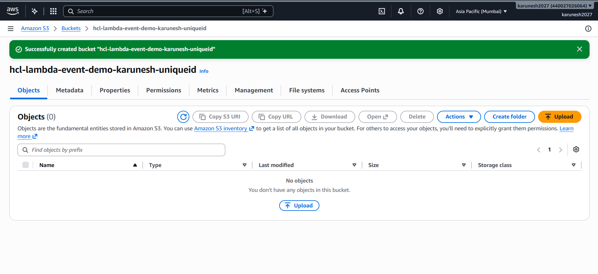
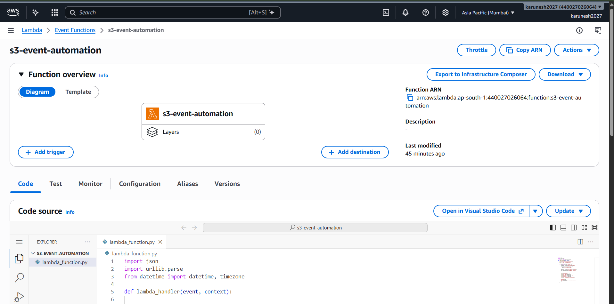
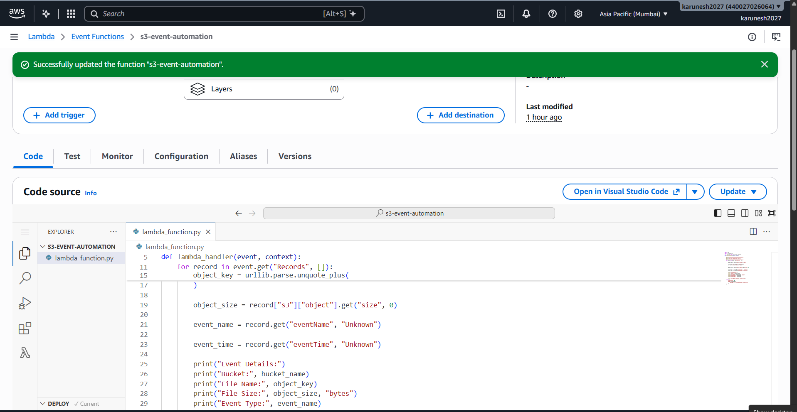
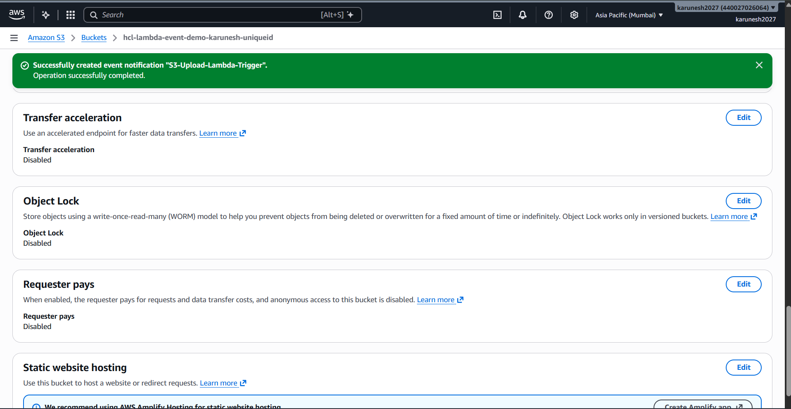
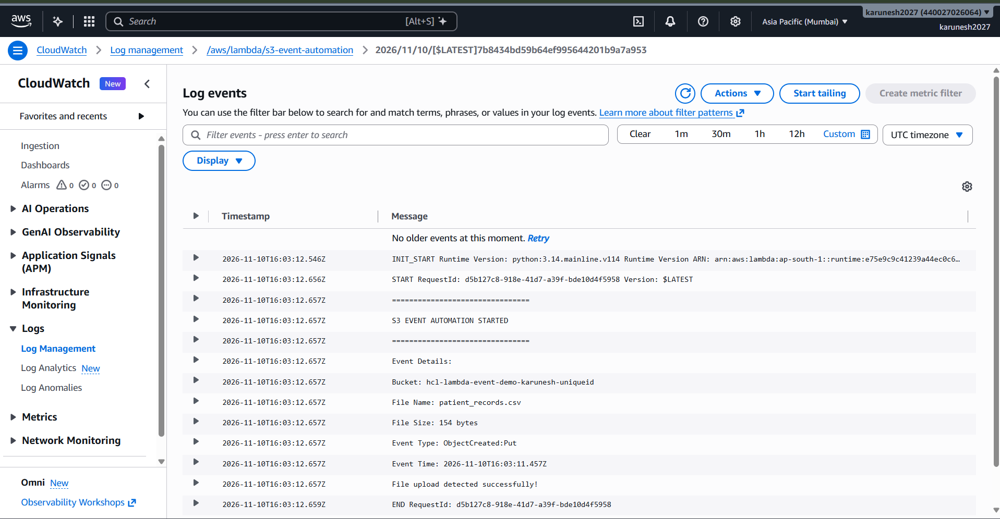

# ⚡ AWS S3 Event-Driven Automation Using Lambda

<p align="center">
  
  
  
  
  
</p>

<p align="center">
  <b>Automating file upload detection using Amazon S3 event notifications and AWS Lambda.</b>
  <br/>
  <i>A serverless, event-driven automation project implemented using AWS.</i>
</p>

---

## 📌 Project Overview

This project demonstrates an event-driven serverless architecture using Amazon S3 and AWS Lambda.

Whenever a CSV file is uploaded to a configured S3 bucket, an event notification automatically invokes a Python-based Lambda function.

The function extracts uploaded file metadata, including the bucket name, object key, file size and event type. Execution details are recorded in Amazon CloudWatch Logs.

The implementation eliminates the need for continuously running servers or manual file monitoring.

## 🎯 Project Objectives

- Understand event-driven architecture in AWS.
- Configure Amazon S3 event notifications.
- Integrate S3 with AWS Lambda.
- Develop a Python-based serverless function.
- Configure IAM execution permissions.
- Monitor Lambda execution using CloudWatch.
- Implement file-type filtering using event notification suffixes.

## 🏗️ Architecture

```text
             USER / CLIENT
                   |
                   | Upload CSV File
                   v
              AMAZON S3
              (Input Bucket)
                   |
          ObjectCreated Event
             (*.csv filter)
                   |
                   v
             AWS LAMBDA
          (Python Function)
                   |
          Extract File Metadata
                   |
                   v
          AMAZON CLOUDWATCH
             (Execution Logs)
```

### Architecture Components

| AWS Service | Responsibility |
|---|---|
| Amazon S3 | Stores uploaded files and generates object creation events |
| AWS Lambda | Executes Python code when invoked |
| AWS IAM | Provides Lambda execution permissions |
| Amazon CloudWatch | Stores function execution logs |

## 🛠️ Technology Stack

- Amazon Web Services (AWS)
- Amazon S3
- AWS Lambda
- AWS IAM
- Amazon CloudWatch
- Python
- Git and GitHub

## ⚙️ Implementation Workflow

### 1. Create an S3 Bucket

Created a dedicated Amazon S3 bucket to receive uploaded files.

The bucket is configured as a private storage location with default encryption enabled.

### 2. Create an AWS Lambda Function

Created a Lambda function named `s3-event-automation`.

Configured the function using a Python runtime and an IAM execution role with basic CloudWatch logging permissions.

### 3. Develop the Python Function

Implemented a Lambda handler to:

- Receive S3 event information.
- Extract the bucket name.
- Retrieve the uploaded object key.
- Extract object size.
- Identify the event type and timestamp.
- Print execution details to CloudWatch.

### 4. Configure S3 Event Notifications

| Configuration | Value |
|---|---|
| Event name | S3-Upload-Lambda-Trigger |
| Event type | All object create events |
| Suffix filter | `.csv` |
| Destination | AWS Lambda |
| Lambda function | `s3-event-automation` |

The suffix filter ensures that only matching CSV object creation events invoke the function.

### 5. Monitor Execution Using CloudWatch

Used Amazon CloudWatch Logs to verify successful Lambda execution.

The logs capture the uploaded filename, bucket name, file size and event details.

## 💻 Lambda Function

The implementation is available in `lambda_function.py`.

The function uses the Python `lambda_handler(event, context)` entry point to process S3 event records.

## 🧪 Testing and Validation

Performed the following tests to verify the automation.

| Test Case | Expected Result | Actual Result |
|---|---|---|
| Upload a CSV file | Lambda should execute | ✅ Passed |
| Extract bucket name | Bucket name appears in logs | ✅ Passed |
| Extract object key | Filename appears in logs | ✅ Passed |
| Extract object size | File size appears in logs | ✅ Passed |
| Upload a TXT file | Lambda should not execute | ✅ Passed |

### Sample CloudWatch Output

```text
S3 EVENT AUTOMATION STARTED

Event Details:

Bucket: hcl-lambda-event-demo-karunesh-uniqueid

File Name: patient_records.csv

File Size: 154 bytes

Event Type: ObjectCreated:Put

File upload detected successfully!
```

---

# 📸 Project Implementation Screenshots

The following screenshots demonstrate the actual AWS implementation and successful testing.

### 1. Amazon S3 Bucket Creation

Dedicated S3 bucket configured to receive uploaded files.



### 2. AWS Lambda Function

Created and configured the Lambda function for event-driven automation.



### 3. Python Lambda Implementation

Python code responsible for extracting S3 event details and recording execution information.



### 4. S3 Event Notification Configuration

Configured the S3 event notification with a `.csv` suffix filter and connected it to the Lambda function.



### 5. CloudWatch Execution Logs

Successfully verified automatic Lambda invocation after uploading `patient_records.csv`.



---

## 🔐 Security Considerations

- Used a dedicated private S3 bucket.
- Kept S3 Block Public Access enabled.
- Configured a Lambda execution role with basic logging permissions.
- Used S3 invocation permissions for the configured Lambda function.
- Avoided unnecessary public access to stored objects.
- Followed the principle of least privilege.

## 🚀 Future Enhancements

- Process uploaded CSV files using Python.
- Add automatic file validation.
- Move processed files to a separate S3 bucket or prefix.
- Integrate Amazon SNS for automated notifications.
- Add error handling and failure monitoring.
- Extend the workflow into a complete data engineering pipeline.

## 📂 Project Structure

```text
aws-s3-event-driven-lambda/
│
├── lambda_function.py
├── README.md
│
└── screenshots/
    ├── 01-s3-bucket.png
    ├── 02-lambda-function.png
    ├── 03-lambda-function-code.png
    ├── 04-s3-event-notification.png
    └── 05-cloudwatch-logs.png
```

## 👨‍💻 Project Information

| Detail | Description |
|---|---|
| Project | AWS S3 Event-Driven Automation Using Lambda |
| Category | Cloud Computing / Serverless Architecture |
| Training | HCLTech Cloud Engineering Training |
| Cloud Provider | Amazon Web Services |
| Runtime | Python |
| Status | Successfully Implemented and Tested |

---

<p align="center">
  <b>⚡ Automating workflows with AWS Serverless Architecture.</b>
  <br/>
  <sub>Hands-on cloud engineering through practical implementation.</sub>
</p>